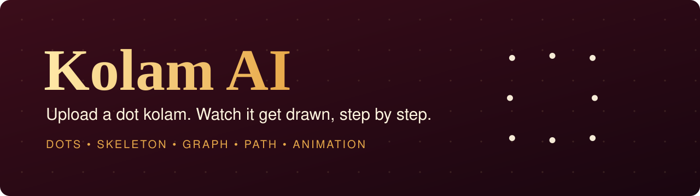
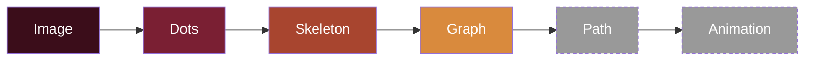
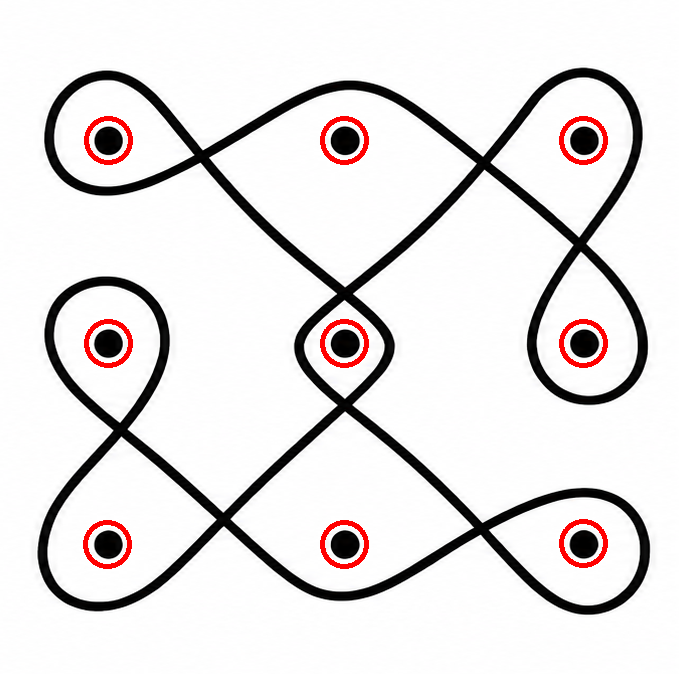
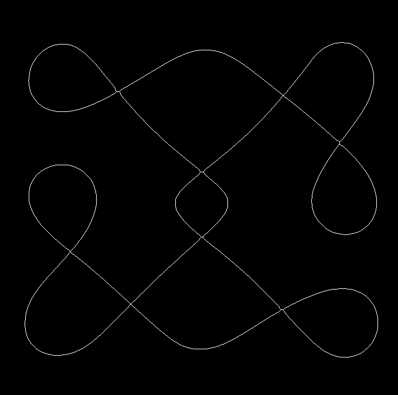
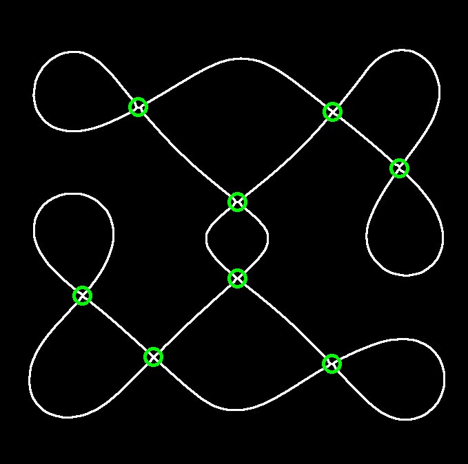
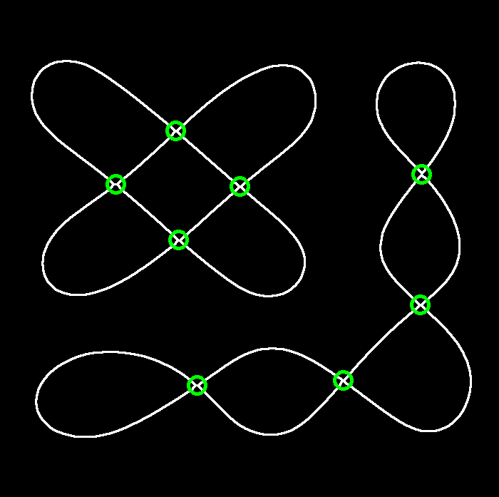

<div align="center">



<br>


**[Live app](https://kolam-ai.streamlit.app)** &nbsp;•&nbsp; **[How it works](#-how-it-works)** &nbsp;•&nbsp; **[Results](#-results)** &nbsp;•&nbsp; **[Run it](#-run-it-locally)** &nbsp;•&nbsp; **[Roadmap](#-roadmap)**

</div>

<br>

> [!NOTE]
> **Work in progress.** Dot detection, skeleton and graph are finished and tested on 4 images. The drawing path, animation and full app are being built (sprint: 6 to 9 Nov 2026). The live link currently shows a hello-world deploy test.

## 🪔 The idea

A **kolam** is a South Indian line drawing made around a grid of dots. The line never touches the dots. It loops around them and crosses itself, and it is drawn in one smooth movement.

Learning a kolam from a finished picture is hard. You can see *what* it looks like, but not *how the hand moves*.

**Kolam AI** takes a picture of a dot kolam and works out how to draw it, so that it can replay the drawing step by step.

<br>

## 🔍 How it works

No deep learning. Every stage is classical computer vision, so each step can be seen and explained.



<sub>Solid boxes are done. Dashed boxes are in progress.</sub>

<br>

<table>
  <tr>
    <td align="center"></td>
    <td align="center"></td>
    <td align="center"></td>
  </tr>
  <tr>
    <td align="center"><b>1. Find the dots</b><br><sub>Blur, Otsu threshold, keep only round shapes of the right size</sub></td>
    <td align="center"><b>2. Thin the lines</b><br><sub>Erase dots and specks, then shrink every line to 1 pixel</sub></td>
    <td align="center"><b>3. Build the graph</b><br><sub>Green rings are crossings. Lines between them are edges</sub></td>
  </tr>
</table>

<br>

| Stage | What it does | Tools |
| --- | --- | --- |
| **Dots** | Finds every dot and circles it in red | `GaussianBlur`, Otsu threshold, shape size and roundness tests |
| **Skeleton** | Removes dots and specks, thins the kolam line to 1 pixel | `skimage.morphology.skeletonize` |
| **Graph** | Counts each pixel's neighbours to find crossings and dead ends, then joins them as nodes and edges | `filter2D`, `dilate`, NetworkX `MultiGraph` |
| **Path** | Orders the edges the way a hand would draw them (one stroke per connected piece) | Eulerian circuit *(in progress)* |
| **Animation** | Draws the dots, then the line, step by step with a speed control | Matplotlib *(in progress)* |

<details>
<summary><b>Why the graph makes one-stroke drawing possible</b></summary>

<br>

In every test kolam, each crossing has exactly 4 lines meeting at it (an even number). A connected piece where every crossing is even can be traced in **one continuous stroke** that ends where it started. This is called an Eulerian circuit, and the drawing path stage uses it.

</details>

<br>

## 📊 Results

Tested on 4 clean, top-down, digital kolam images. All numbers were checked by eye against the pictures.

| Image | Dots found | Junctions | Endpoints | Edges | Separate pieces |
| :---: | :---: | :---: | :---: | :---: | :---: |
| k01 | 9 / 9 | 8 | 0 | 16 | 1 |
| k02 | 9 / 9 | 16 | 0 | 32 | 1 |
| k03 | 9 / 9 | 8 | 0 | 16 | 2 |
| k04 | 9 / 9 | 10 | 0 | 20 | 1 |

<div align="center">

<br>
<sub><b>k03</b> has two separate pieces. The graph finds this on its own.</sub>

</div>

<br>

## ⚙️ Run it locally

```bash
git clone https://github.com/tejasree0906-git/KolamAI.git
cd KolamAI

python -m venv .venv
.venv\Scripts\activate          # Windows
pip install -r requirements.txt

python src/detect_dots.py       # dots, skeleton
python src/build_graph.py       # graph
streamlit run app/app.py        # app (hello-world for now)
```

Run all commands from the project root. Input images go in `data/real/`, outputs are saved in `results/`.

<details>
<summary><b>Project layout</b></summary>

```
KolamAI/
├── src/            detect_dots.py, build_graph.py
├── app/            app.py  (Streamlit)
├── data/real/      input kolam images (k01 to k04)
├── results/        red dots, skeleton and graph pictures
├── docs/           journals, failure log, images
└── requirements.txt
```

</details>

<br>

## ⚠️ Honest limitations

- Works on **clean, top-down, digital** dot kolams. Hand-drawn paper photos gave uneven lines and are not supported yet.
- Tested on **4 images** only. The dot-size range is tuned to these and will need retuning for more images.
- Street photos with shadows, tilt or faded powder are future work.

A full list of what went wrong and how it was fixed is in [`docs/failures.md`](docs/failures.md).

<br>

## 🗺️ Roadmap

| | Step |
| :---: | --- |
| ✅ | Dot detection |
| ✅ | Skeleton |
| ✅ | Graph of crossings and lines |
| ✅ | Hello-world deploy on Streamlit Community Cloud |
| 🔨 | Drawing path (Eulerian circuit) |
| 🔨 | Step-by-step drawing animation |
| 🔨 | Full Streamlit app: upload, dots, skeleton, animation, speed slider |
| 🔜 | More kolam images, retuned detection |
| 🔜 | Symmetry analysis, motif extraction, photos taken in the street |

<br>

<div align="center">

**Tejasree E** &nbsp;•&nbsp; B.E. AI & ML, New Horizon College of Engineering, Bangalore
<br>
<sub>Societal Based Mini Project (24AIM57)</sub>

</div>
