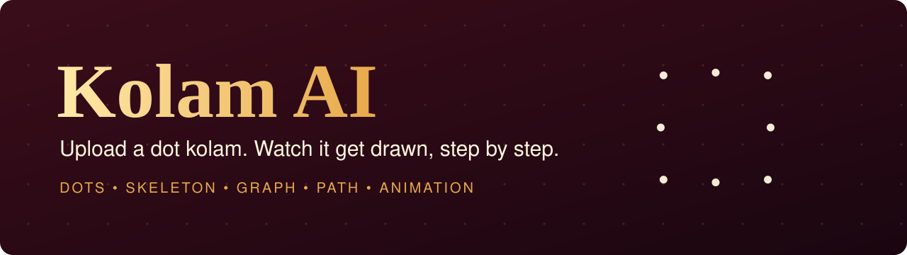
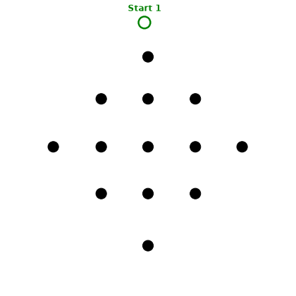
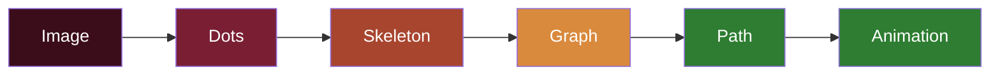
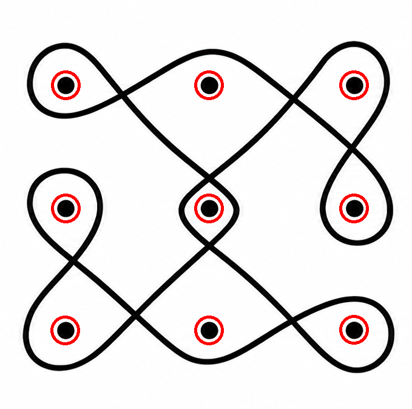
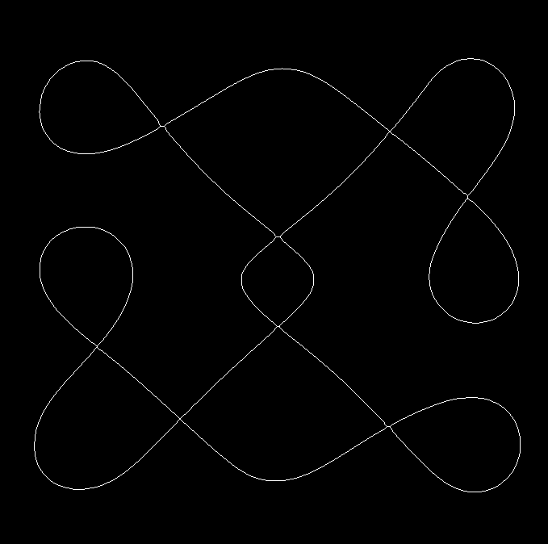
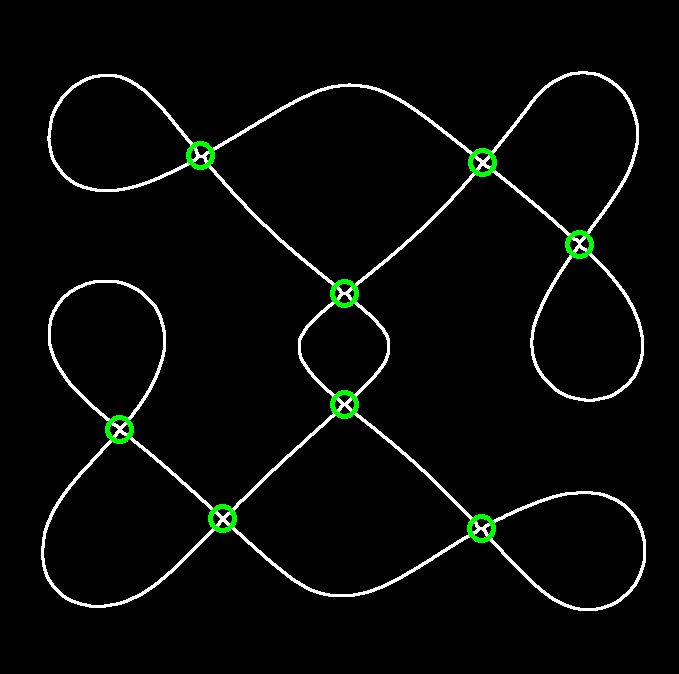

<div align="center">



<br>


**[Live app](https://kolam-ai.streamlit.app)** &nbsp;•&nbsp; **[How it works](#-how-it-works)** &nbsp;•&nbsp; **[Results](#-results)** &nbsp;•&nbsp; **[Run it](#-run-it-locally)** &nbsp;•&nbsp; **[Roadmap](#-roadmap)**

</div>

<br>

## 🪔 The idea

A **kolam** is a South Indian line drawing made around a grid of dots. The line never touches the dots. It loops around them and crosses itself, and it is drawn in one smooth movement.

Learning a kolam from a finished picture is hard. You can see *what* it looks like, but not *how the hand moves*.

**Kolam AI** takes a picture of a clean dot kolam, works out how a hand would draw it, and replays the drawing step by step: dots first, then the line, slowly enough to copy.

<div align="center">

<br>
<sub>The app's animation for <b>k24</b>. Dots appear first, then the line is drawn.</sub>

</div>

<br>

## 🔍 How it works

No deep learning and nothing is trained. Every stage is classical computer vision, so each step can be seen and explained.



<br>

<table>
  <tr>
    <td align="center"></td>
    <td align="center"></td>
    <td align="center"></td>
  </tr>
  <tr>
    <td align="center"><b>1. Find the dots</b><br><sub>Blur, Otsu threshold, keep only round shapes of the right size</sub></td>
    <td align="center"><b>2. Thin the lines</b><br><sub>Erase dots and specks, then shrink every line to 1 pixel</sub></td>
    <td align="center"><b>3. Build the graph</b><br><sub>Green rings are crossings. Lines between them are edges</sub></td>
  </tr>
</table>

<br>

| Stage | What it does | Tools |
| --- | --- | --- |
| **Dots** | Finds every dot. Keeps a shape only if its area (100 to 4000 px), box shape and roundness fit. A small shape sitting inside a bigger dot is ignored | `GaussianBlur`, Otsu threshold, `connectedComponentsWithStats` |
| **Skeleton** | Removes dots, specks and the frame, thins the line to 1 pixel, cuts tiny tails (15 px or less) and tiny loose pieces (under 50 px) | `skimage.morphology.skeletonize` |
| **Graph** | Counts each pixel's neighbours to find crossings and dead ends. Joins them as nodes and edges. Two crossings linked by a road of 5 px or less become one | `filter2D`, `dilate`, NetworkX `MultiGraph` |
| **Path** | At every crossing, pairs the two road ends that point most opposite, so the line goes straight through like a hand. Follows the pairs until the line closes | dot product of directions |
| **Animation** | Draws the dots, then the line, step by step. Every dot has the same size. Default speed is 5, slider 2 to 20 | Matplotlib `FuncAnimation` |

**Two safety locks** stop a bad picture before it draws a wrong animation:

| Lock | Stops when |
| --- | --- |
| Lock 1 | a crossing has an odd number of roads (a loose line end) |
| Lock 2 | a drawn strand does not close |

The app then shows a friendly message instead of a broken drawing.

<details>
<summary><b>Why the graph makes one-stroke drawing possible</b></summary>

<br>

Where every crossing has an even number of lines (4 in our pictures), a connected piece can be traced in one continuous stroke that ends where it started. This is an Eulerian circuit. A plain Eulerian walk can turn sharply at a crossing, which a hand would not do. So the path stage uses the straight-through rule on top of it.

</details>

<br>

## 📊 Results

Evaluated on a **test set of 25 clean, top-down dot kolams** (k01 to k25). Nothing is trained. The correct dot count of every picture was written by hand **before** running the program (`data/labels.csv`).

k05 to k25 were hand-drawn on paper and digitized with ChatGPT.

| Run | Change | Dots correct | Whole pipeline OK |
| --- | --- | :---: | :---: |
| baseline | none | not recorded | 18 / 25 (72%) |
| after fix 1 | min dot area 150 to 100 | 24 / 25 | 23 / 25 |
| after fix 2 | max dot area 4000 to 300 *(a guess, backfired)* | 21 / 25 | 19 / 25 |
| after fix 3 | min 120, max back to 4000 | 24 / 25 | 21 / 25 |
| after fix 4 | cut tiny tails (15 px) | 24 / 25 | 23 / 25 |
| after fix 5 | drop tiny skeleton pieces (50 px) | 24 / 25 | 24 / 25 |
| after fix 6 | min 100 + duplicate-dot rule | 25 / 25 | 25 / 25 |
| **after fix 8** | glue split crossings (5 px) | **25 / 25** | **25 / 25** |

| Group | Pictures | Pipeline OK |
| --- | :---: | :---: |
| 3x3 dots (9) | 15 | 15 / 15 |
| 2-4-4-2 dots (12) | 5 | 5 / 5 |
| 1-3-5-3-1 dots (13) | 5 | 5 / 5 |

Every number came from measuring first (small diagnostic scripts), then changing one thing, then re-running all 25. The full story, with proof for each fix, is in [`docs/failures.md`](docs/failures.md).

**Bad-input tests** (blurry picture, huge picture, a text file renamed `.png`, a blank picture) do not crash the app. It shows a friendly message or runs normally.

<br>

## ⚙️ Run it locally

```bash
git clone https://github.com/tejasree0906-git/KolamAI.git
cd KolamAI

python -m venv .venv
.venv\Scripts\activate          # Windows
pip install -r requirements.txt

streamlit run app/app.py                    # the app
python src/pipeline.py data/real/k03.png    # one picture, no app
python run_all.py my_run                    # all 25 pictures, saves a csv and a log
```

Run all commands from the project root. Input images go in `data/real/`, outputs are saved in `results/`.

<details>
<summary><b>Project layout</b></summary>

```
KolamAI/
├── src/
│   ├── detect_dots.py     dots, curve cleanup, skeleton
│   ├── build_graph.py     spur prune, speck drop, graph
│   ├── trace_path.py      straight-through strands
│   ├── animate_path.py    path to GIF
│   └── pipeline.py        all stages + the two locks
├── app/app.py             Streamlit app
├── run_all.py             run all 25 pictures
├── *_diag.py              small measuring scripts
├── data/                  real/ pictures, labels.csv
├── results/               pictures, GIFs, run csv files
├── docs/                  journals, failure log, images
└── requirements.txt
```

</details>

<br>

## ⚠️ Honest limitations

- Works on **clean, top-down dot kolams** only. Street photos with shadows, tilt or faded powder are not supported.
- The sizes (min dot 100 px, tail 15 px, speck 50 px, glue 5 px) were chosen on the **same 25 pictures** used to test. So 100% is **not** a fair estimate for new pictures.
- A real tail shorter than 15 px would be cut. A real dot smaller than 100 px would be missed.
- The locks check the result, not the blur itself.
- 100% means the strands close. It does not prove the path looks right. Only **11 of 25** pictures were checked by eye (finger test). One picture (k10) passed both locks and was still wrong until the eye caught it.
- Every upload is saved under one file name, so two people at the same time could overwrite each other. Fine for a demo.

<br>

## 🗺️ Roadmap

| | Step |
| :---: | --- |
| ✅ | Dot detection, skeleton, graph |
| ✅ | Straight-through drawing path |
| ✅ | Step-by-step animation with speed slider |
| ✅ | Streamlit app, deployed on Streamlit Community Cloud |
| ✅ | Two safety locks and bad-input tests |
| 🔜 | A fresh test set the settings were not tuned on |
| 🔜 | Automatic check that the path looks right, not only that it closes |
| 🔜 | Tail and speck sizes relative to image size |
| 🔜 | Photos taken in the street (shadows, tilt) |
| 🔜 | Symmetry analysis and motif extraction |

<br>

<div align="center">

**Tejasree E** &nbsp;•&nbsp; B.E. AI & ML, New Horizon College of Engineering, Bangalore
<br>
<sub>Societal Based Mini Project (24AIM57)</sub>

</div>
